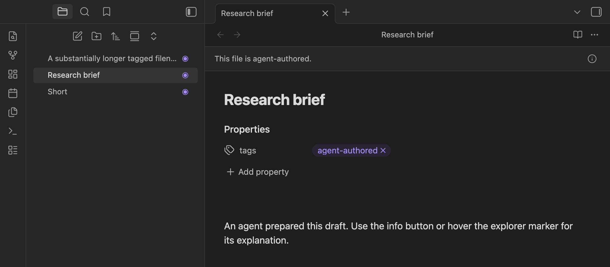
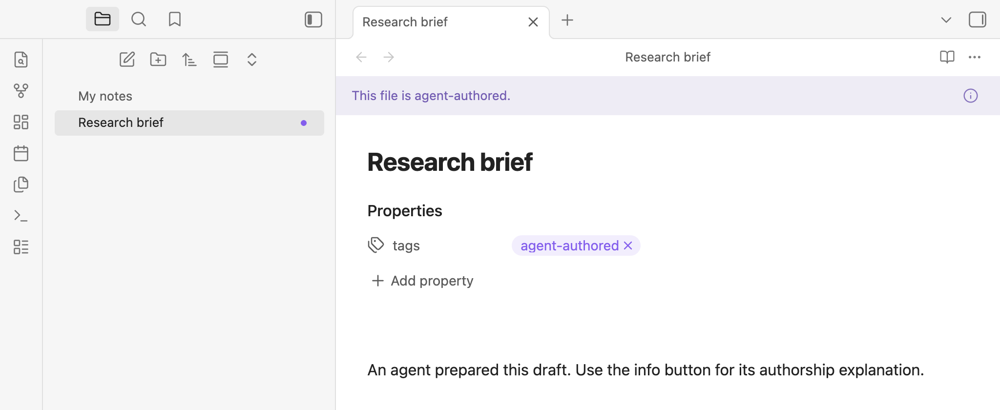

# Iris

Spot agent-authored notes at a glance in Obsidian.

| Dark theme | Light theme |
| --- | --- |
|  |  |

## Features

- **Recognize the note you're reading.** A compact banner identifies agent-authored files in reading and editing views. Its info button explains why it appears.
- **Find them in the explorer.** Right-aligned dot-and-ring markers use your theme's accent color and work alongside [Color Tags](https://github.com/markosnarinian/obsidian-color-tags).
- **Choose your indicators.** Toggle the banner and explorer markers independently in **Settings → Iris**.
- **Keep your vault private.** No network requests or telemetry. Notes change only when you run a tagging command.

## Tagging notes

Add `#agent-authored` inline or `agent-authored` to the note's `tags` property. Nested tags such as `#agent-authored/reviewed` also qualify; matching is case-insensitive. Tags inside code do not count. Iris uses explicit tags, not AI detection.

Two command-palette actions edit **file properties only**:

- **Iris: Add agent-authored tag to file properties** adds the exact root tag without duplicating it or removing existing nested tags.
- **Iris: Remove agent-authored tag from file properties** removes the root tag and all its descendants, preserving unrelated tags and properties.

Neither command changes inline tags or the note body. A matching inline tag will keep the indicators visible after property tags are removed. Obsidian may reformat YAML when updating properties.

## Install locally

Requires **Obsidian 1.8.7+**. Not yet listed in the community directory.

1. Build from source using the commands below.
2. Copy `main.js`, `manifest.json`, and `styles.css` into `<vault>/.obsidian/plugins/iris/`.
3. Enable **Iris** in **Settings → Community plugins**.

## Development

Use Node.js 22.12+ or 24+ and a separate development vault.

```sh
npm ci
npm test
npm run lint
npm run build
```

`npm run dev` rebuilds on changes. Reload Iris in your development vault to test updates. See Obsidian's [plugin tutorial](https://docs.obsidian.md/Plugins/Getting+started/Build+a+plugin) for setup guidance.

## License

MIT. Build tooling is adapted from the [official Obsidian sample plugin](https://github.com/obsidianmd/obsidian-sample-plugin) (0-BSD).
