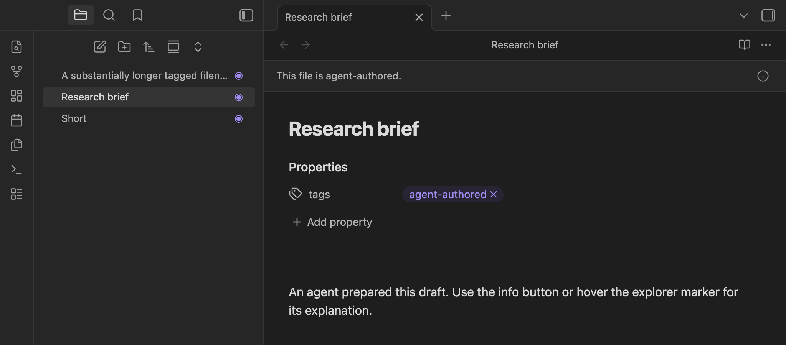
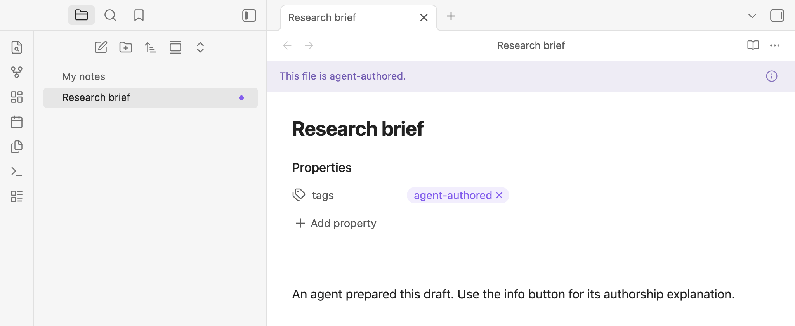

# Iris Companion

Spot agent-authored notes at a glance in Obsidian.

| Dark theme | Light theme |
| --- | --- |
|  |  |

## Features

- **Recognize the note you're reading.** A filled banner identifies agent-authored files in reading and editing views. Files containing agent-authored material have an unfilled, accent-outlined banner with accent-colored text. Each banner's info button explains why it appears.
- **Find them in the explorer.** Right-aligned dots mark agent-authored files; hollow dots mark files containing agent-authored material. Both use your theme's accent color and work alongside [Color Tags](https://github.com/markosnarinian/obsidian-color-tags).
- **Choose your indicators.** Toggle the banner and explorer markers independently in **Settings → Iris Companion**.
- **Keep your vault private.** No network requests or telemetry. Notes change only when you run a tagging command.

## Tagging notes

Use `#agent-authored` for a file authored by an agent, or `#contains-agent-authored` for a file that only contains agent-authored material. Add either tag inline or to the note's `tags` property (without `#`). Nested tags such as `#agent-authored/reviewed` and `#contains-agent-authored/reviewed` also qualify; matching is case-insensitive. If both kinds are present, whole-file authorship takes precedence. Tags inside code do not count. Iris uses explicit tags, not AI detection.

Command-palette actions edit **file properties only**:

- **Iris Companion: Add agent-authored tag to file properties** adds the exact root tag without duplicating it or removing existing nested tags.
- **Iris Companion: Remove agent-authored tag from file properties** removes the root tag and all its descendants, preserving unrelated tags and properties.
- **Iris Companion: Add contains-agent-authored tag to file properties** adds the material tag without duplicating it or removing existing nested tags.
- **Iris Companion: Remove contains-agent-authored tag from file properties** removes the material tag and all its descendants, preserving whole-file authorship tags and unrelated properties.

None of these commands changes inline tags or the note body, or removes the other kind of authorship tag. A matching inline tag will keep the indicators visible after property tags are removed. Obsidian may reformat YAML when updating properties.

## Install locally

Requires **Obsidian 1.8.7+**. Not yet listed in the community directory.

1. Build from source using the commands below.
2. Copy `main.js`, `manifest.json`, and `styles.css` into `<vault>/.obsidian/plugins/iris-companion/`.
3. Enable **Iris Companion** in **Settings → Community plugins**.

## Development

Use Node.js 22.12+ or 24+ and a separate development vault.

```sh
npm ci
npm test
npm run lint
npm run build
```

`npm run dev` rebuilds on changes. Reload Iris in your development vault to test updates. See Obsidian's [plugin tutorial](https://docs.obsidian.md/Plugins/Getting+started/Build+a+plugin) for setup guidance.

For releases and community-directory submission, see [Publishing](docs/publishing.md).

## License

MIT. Build tooling is adapted from the [official Obsidian sample plugin](https://github.com/obsidianmd/obsidian-sample-plugin) (0-BSD).
